<div align="center">

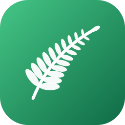

# Fern

[](https://github.com/atabits/fern/releases/latest)
[](https://fern.atabits.com)
[](LICENSE)
[](https://www.rust-lang.org/)
[](https://github.com/atabits/fern/releases/latest)
[](https://github.com/atabits/fern/actions/workflows/ci.yml)

### Tasks, horizons, calendar, habits, focus, and plugins — in one fast native app.

A free, open-source, local-first take on TickTick written in Rust and GPU-rendered with GPUI.  
**No account. No subscription. No cloud required.** Your data stays in SQLite on your machine.

**[🌐 Try the Live Web Preview → fern.atabits.com](https://fern.atabits.com)** &nbsp;·&nbsp; **[⬇️ Download Desktop](https://github.com/atabits/fern/releases/latest)** &nbsp;·&nbsp; **[🧩 Plugin SDK](docs/plugins/README.md)** &nbsp;·&nbsp; **[🔐 Self-Hosted E2EE Sync](docs/self-hosting.md)**

</div>

<br>

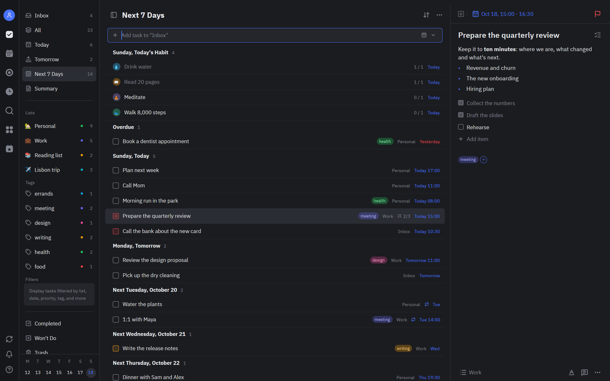

> [!NOTE]
> **Want to explore Fern in 5 seconds without installing anything?**  
> Open the live **[Web Preview at fern.atabits.com](https://fern.atabits.com)** — the exact same Rust, GPUI, and SQLite app compiled to WebAssembly, running locally in your browser's IndexedDB with zero sign-up. For everyday work (global hotkeys, native tray, notifications, local files, and plugins), install the native desktop app below.

---

## ✨ Why Fern

- **⚡️ Native GPU speed — desktop & browser.** Built in Rust with [GPUI](https://github.com/zed-industries/zed) (no Electron, no bundled browser). Launches fast, renders at native refresh rates, and even runs in the browser as a WebAssembly preview.
- **🔭 Plan from today to your whole life.** Combine everyday lists, Kanban boards, timelines, and nested subtasks with **Horizons** (Week → Month → Quarter → Year → Decade → Life), an optional calm **Things View (Beta)**, an **Eisenhower Matrix**, **Sticky Notes**, and **Life Clock**.
- **📅 Calendar, two-way CalDAV, habits & deep focus.** Manage day/week/month/year/agenda views with two-way CalDAV sync and a secondary time zone, track streaks and decimal habits, and stay in flow with Pomodoro/Stopwatch timers, **Focus Mini**, synthesized chimes, and **Ticking** ambient focus sound.
- **⌨️ Keyboard-first & smart by default.** Natural-language Quick Add (English, Russian, and Simplified Chinese), multi-line Batch Add, Batch Edit, global Undo/Redo, rich Markdown with 11 formatting shortcuts, and interactive keymap customization.
- **🧩 Extensible without Electron bloat.** Sandboxed **QuickJS-NG (ES2022)** plugins and Script Runner render **native GPUI views** with deny-by-default permissions, plus live-reloaded custom **JSONC themes**.
- **🔐 Local-first with optional E2EE sync.** Works completely offline out of the box with daily backups and portable mode. Sync across devices on your own `fern-server` with optional client-side **ChaCha20-Poly1305** end-to-end encryption.
- **🌍 Speaks your language & free forever.** English, Russian, and Simplified Chinese (`简体中文`), licensed under AGPL-3.0 — no ads, no paywalls, no tracking.

---

## 📸 A Closer Look

| | |
|---|---|
| 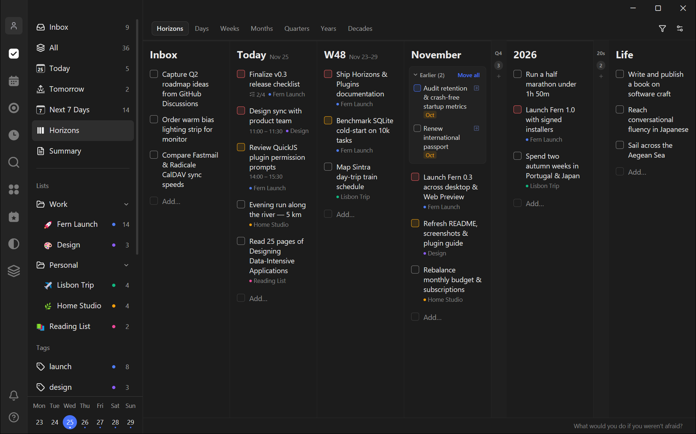 **Horizons:** plan across Inbox, Today, Week, Month (with past-period rollover), Quarter, Year, Decade, and Life. | 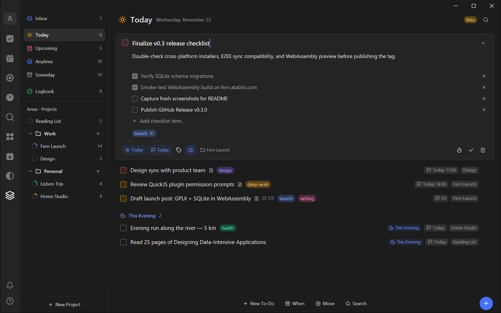 **Things View (Beta):** calm workspace with Areas, Projects, progress donuts, inline cards, and This Evening. |
| 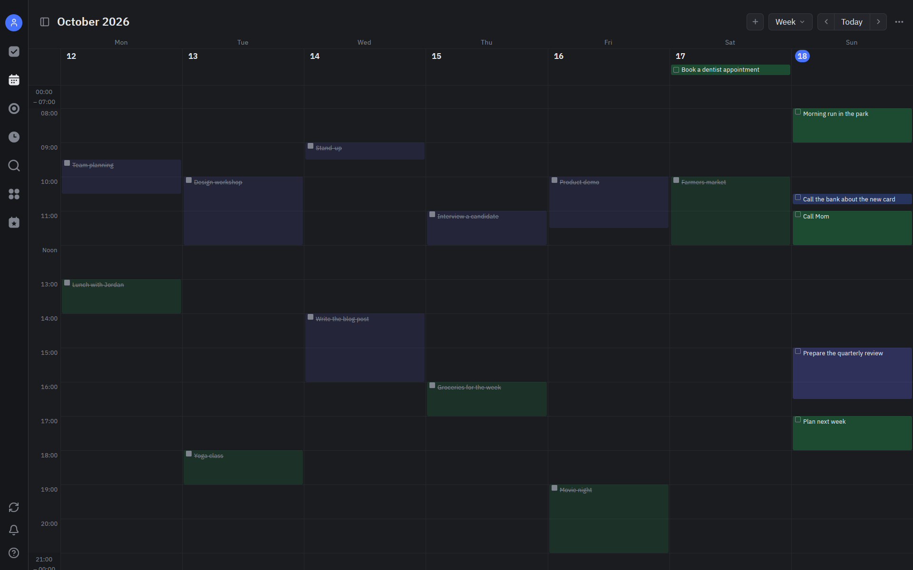 **Calendar & CalDAV:** day, week, month, multi-day, year, and agenda views with two-way CalDAV sync and horizon goal banners. | 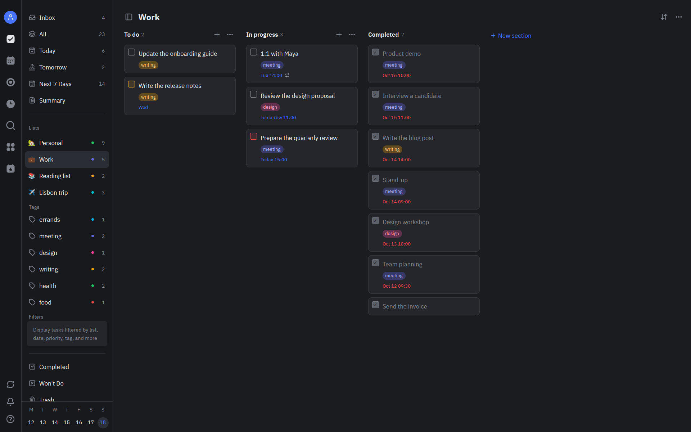 **Kanban & Timeline:** drag-and-drop columns, subsections, nested subtasks, and duration timeline bars. |
| 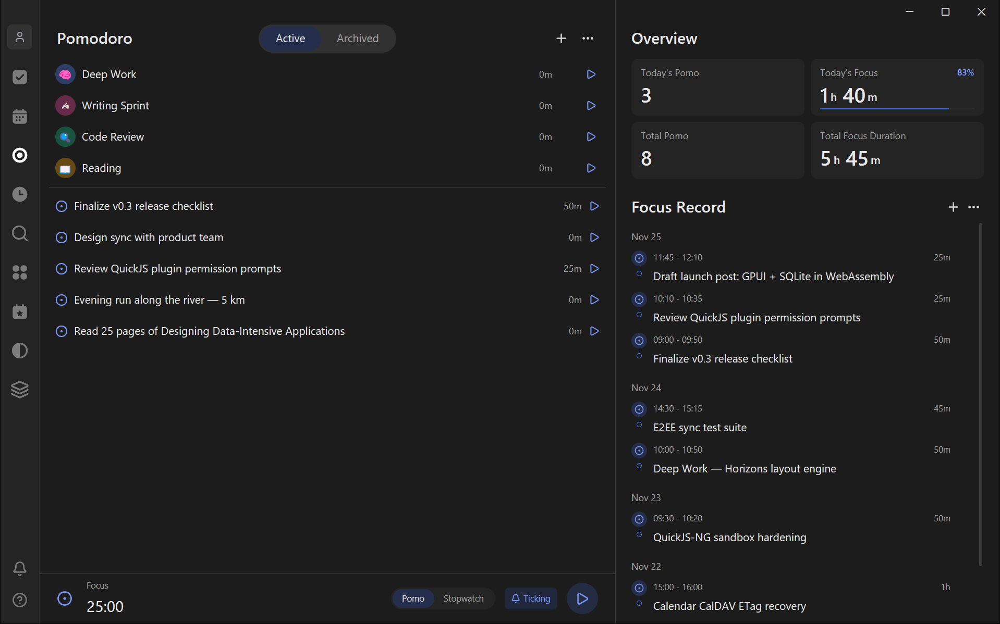 **Focus:** custom Pomodoro & Stopwatch timers, Daily Focus Goal progress, Focus Mini window, and Ticking ambient sound. | 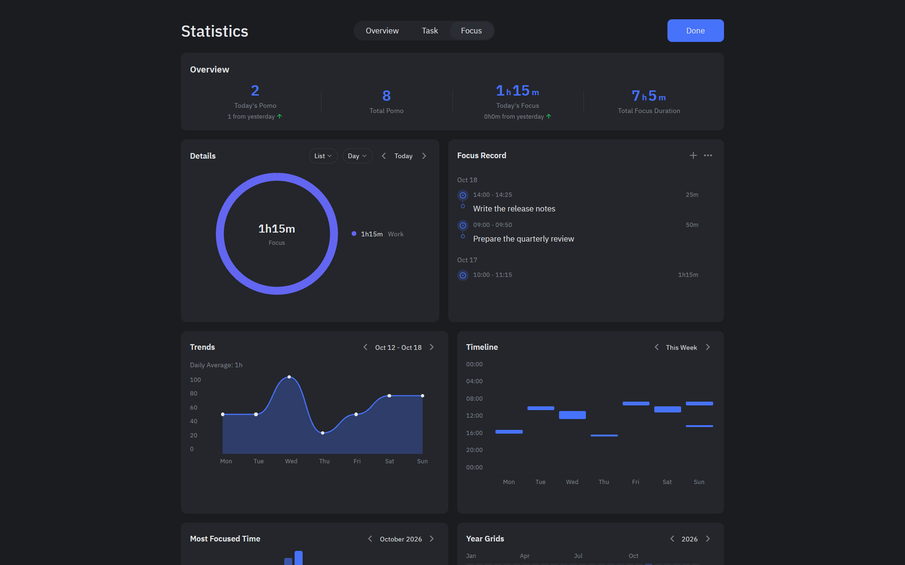 **Statistics:** task and focus trends, timelines, most-focused hours, and year heatmaps. |
| 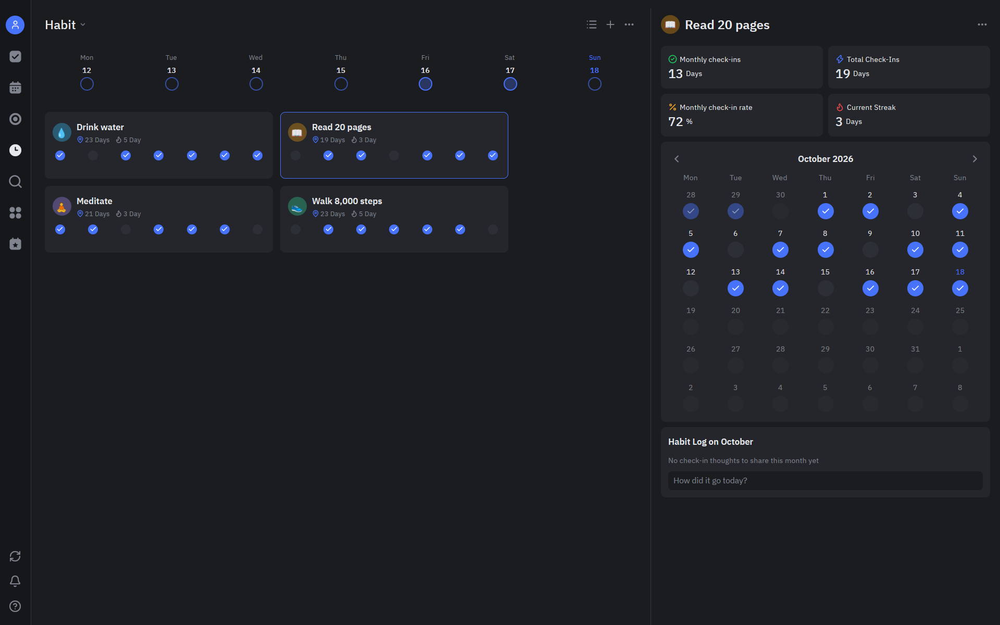 **Habits:** decimal goals, check-in modes, streaks, mood logs, and an interactive 7-day strip. | 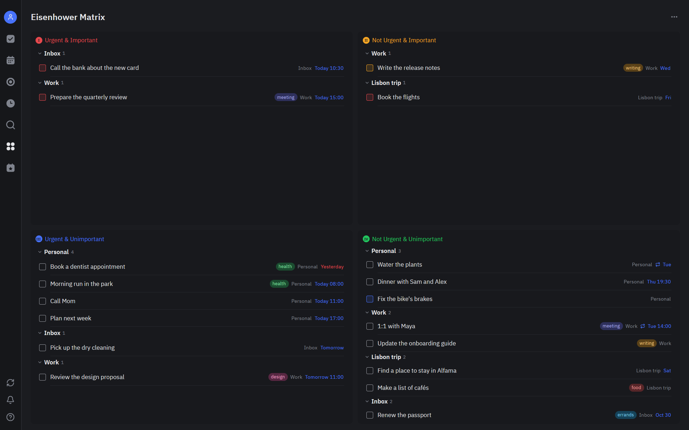 **Eisenhower Matrix:** custom quadrant profiles, rule editor, drag-and-drop, and inline subtasks. |
| 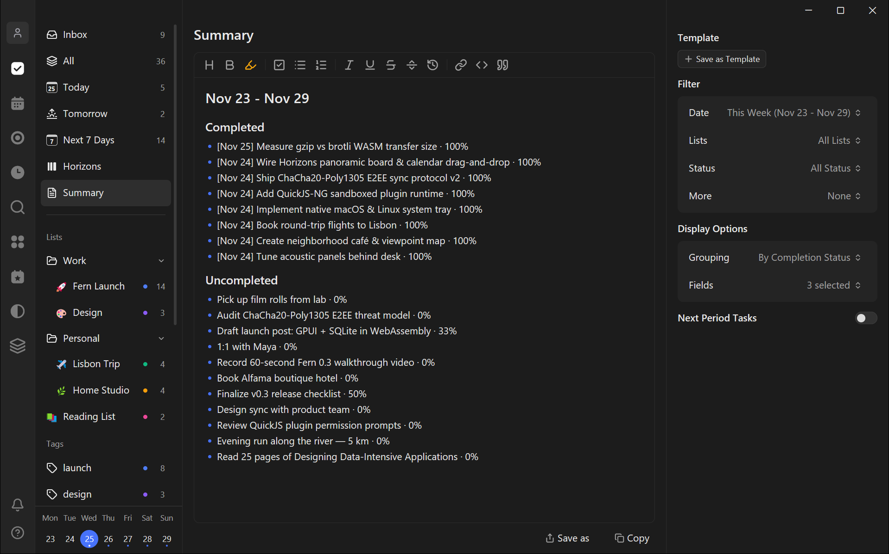 **Summary Reports:** auto-generated Markdown recaps with custom filters, templates, and one-click export. | 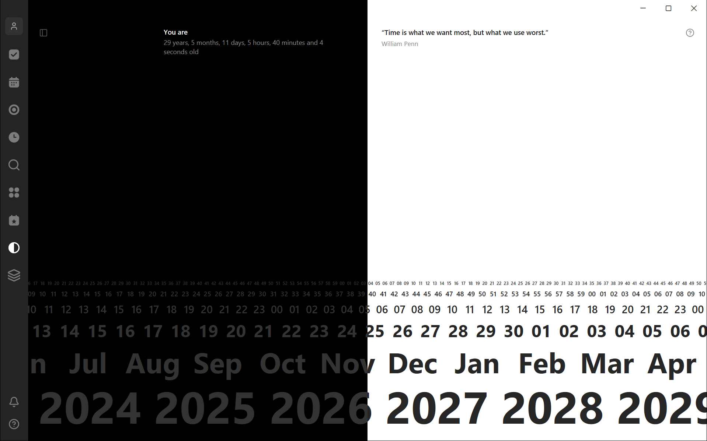 **Life Clock:** meditative split-screen kinetic timeline with live age readout and dual palettes. |
| 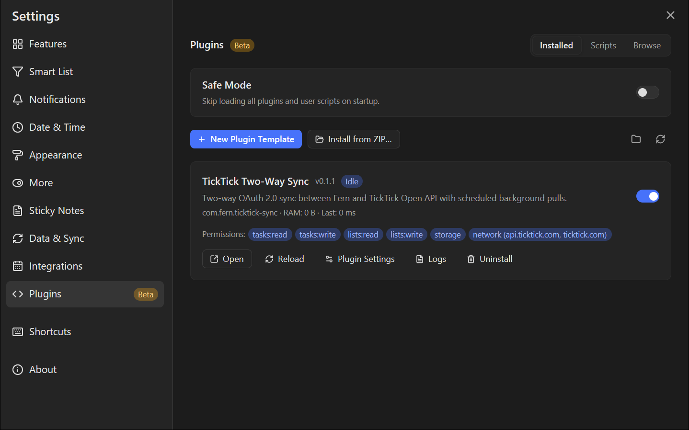 **Plugins (Beta):** sandboxed QuickJS-NG extensions with granular capabilities, Safe Mode, and OAuth 2.0 support. | 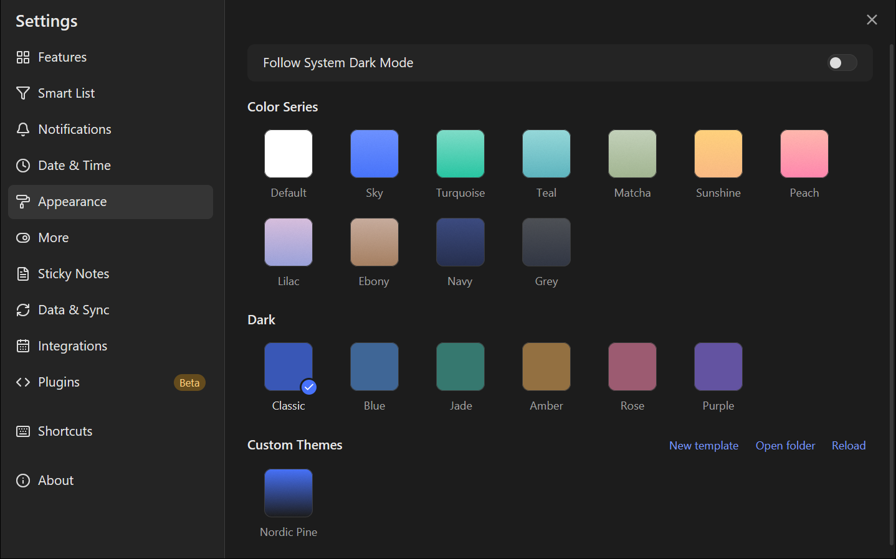 **Themes:** 17 built-in light and dark palettes plus live-reloaded custom JSONC themes. |

<details>
<summary><b>More views: Countdowns & Month Calendar</b></summary>

| | |
|---|---|
| 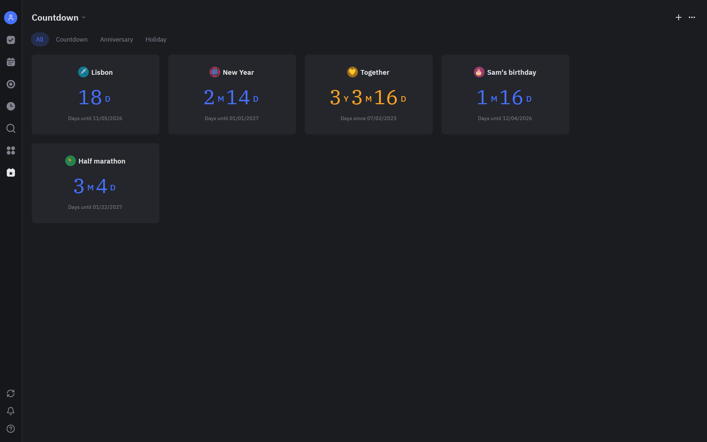 **Countdowns:** trips, birthdays (with optional age), anniversaries, and holidays. | 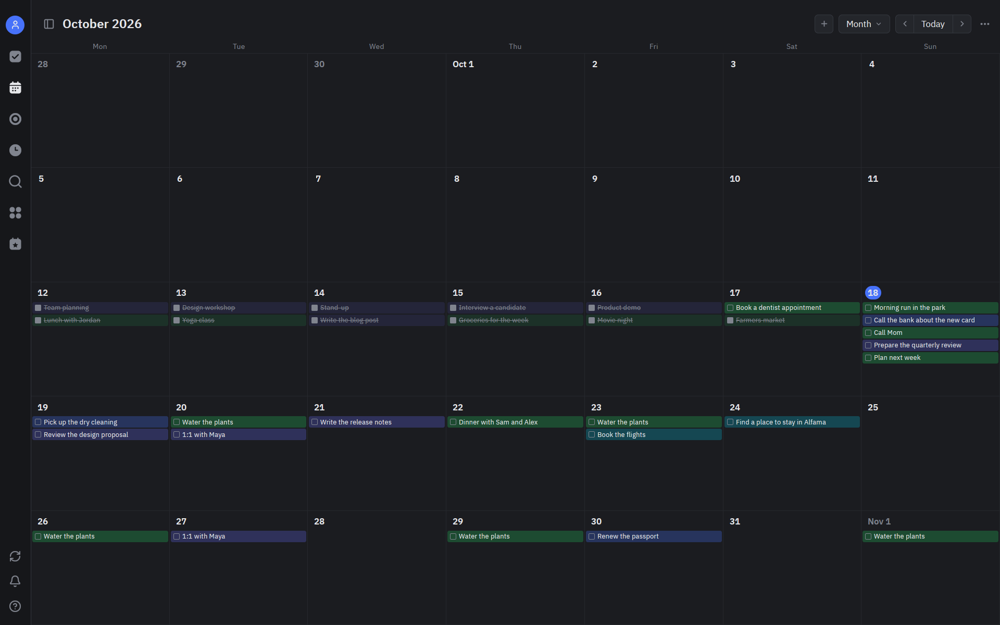 **Month Calendar:** multi-day spans, overflow jump to Day view, and drag-to-reschedule. |

</details>

---

## 🚀 Quick Start

### 1. Try the Web Preview (No Install)

Open **[fern.atabits.com](https://fern.atabits.com)** in any modern browser:
- Runs the same Rust + GPUI + SQLite engine in WebAssembly — no account and no server round-trips.
- Saves your database locally inside the browser's IndexedDB.
- Ready to move to desktop? Export your `.db` backup from **Settings → About** and import it straight into the desktop app (or vice versa).

### 2. Download Desktop (Recommended for Daily Use)

Every [GitHub Release](https://github.com/atabits/fern/releases/latest) includes native builds for all major platforms:

| Platform | Package |
|---|---|
| **macOS** (Apple Silicon / Intel) | `fern-<version>-macos-arm64.dmg` / `fern-<version>-macos-x86_64.dmg` |
| **Windows** (x86_64) | `fern-<version>-windows-x86_64-setup.exe` (installer) or `.zip` (standalone / portable) |
| **Debian / Ubuntu / Linux Mint** | `fern-<version>-linux-<arch>.deb` (`sudo apt install ./fern-*.deb`) |
| **Fedora / RHEL / openSUSE** | `fern-<version>-linux-<arch>.rpm` (`sudo dnf install ./fern-*.rpm`) — plus `packaging/rpm/fern-tasks.spec` for COPR |
| **Arch Linux / EndeavourOS / CachyOS** | `packaging/aur/PKGBUILD` (`fern-tasks-bin` AUR recipe) or `.tar.gz` |
| **NixOS / Nix Flakes** | `nix run github:atabits/fern` (`flake.nix` + `packaging/nix/package.nix`) |
| **Any Linux** (x86_64 / ARM64) | `fern-<version>-linux-<arch>.AppImage`, `.tar.gz`, or Flathub manifest `packaging/flatpak/io.github.atabits.fern.yml` |
| **Sync Server** (every platform) | `fern-server-<version>-<os>-<arch>.tar.gz` / `.zip` |

> **Note on unsigned builds & Linux tips:** Desktop builds are not code-signed yet (see [docs/code-signing.md](docs/code-signing.md)).
> - **macOS:** open **System Settings → Privacy & Security → Open Anyway**, or run `xattr -d com.apple.quarantine /Applications/Fern.app`.
> - **Windows:** in SmartScreen, click **More info → Run anyway**.
> - **Linux & Wayland:** see [docs/linux-distribution.md](docs/linux-distribution.md). On Wayland compositors (GNOME, KDE, Hyprland, Sway), bind global shortcuts directly to `fern --quick-add`, `fern --toggle`, or `fern --focus-mini` (forwarded over the single-instance Unix socket).

### 3. Build from Source

```bash
git clone https://github.com/atabits/fern.git
cd fern
cargo run --release -p fern_desktop
```

Requirements: stable Rust plus platform build tools:
- **Linux:** GPUI system libraries (Wayland/X11, xkbcommon, Vulkan, fontconfig) — on Debian/Ubuntu run `script/linux-deps`.
- **macOS:** Xcode (Metal shader toolchain), macOS 11+.
- **Windows:** Visual Studio Build Tools with the *Desktop development with C++* workload.

---

## 📖 How to Use

### ⌨️ Smart Quick Add & Batch Add

Type naturally in any add bar or in the global **Quick Add** window — Fern highlights recognized tokens live in **English, Russian, and Simplified Chinese**:

| Syntax | Examples | Sets |
|---|---|---|
| **Dates & Spans** | `today`, `tomorrow`, `friday`, `11/25`, `next week`, `weekend` | Due date |
| **Times & Periods** | `6pm`, `18:30`, `morning`, `noon`, `evening` | Due time |
| **Horizons** | `this week`, `this month`, `this year`, `in life` | Horizon bucket |
| **Repeats** | `every weekday`, `every other week`, `biweekly`, `every weekend` | Recurrence rule |
| **Priority** | `!1`–`!3`, `!!!`, `!!`, `!h` / `!m` / `!l`, `!p1`–`!p3` | Priority level |
| **Tags & Lists** | `#work`, `#design`, `^Launch`, `~Personal` | Tags and target list |

- **Example:** `Prepare v0.3 release friday 2pm every week #launch !1 ^Work`
- **Batch Add:** Paste multiple lines into Quick Add to create all tasks at once via a confirmation dialog.
- **Advanced Recurrence:** Date pickers also support **Ebbinghaus forgetting-curve** intervals, **lunar calendar** dates, specific dates, and **Complete & End Repeat**.

---

### 🗂️ Workspaces, Planning & Views

Enable or hide any section from **Settings → Features** and reorder the navigation rail or lists sidebar by dragging:

- **Tasks (List, Kanban & Timeline):** Switch view mode per list, organize with custom sections and folders, drag-and-drop **multi-level nested subtasks**, select multiple items for **Batch Edit** (reschedule, move, merge, duplicate, convert to note/task), or click any due-date pill to toggle **Countdown Mode** (`in 3 days`).
- **Horizons (`Tasks → Horizons`):** Plan across **Inbox, Today, Week, Month, Quarter, Year, Decade, and Life**. Unfinished past-period goals surface in a rollover card for one-click promotion, and Week/Month/Year goals appear as draggable banners at the top of Calendar views.
- **Things View (Beta):** Toggle in **Settings → Features → Things View** for a calm workspace with **Today**, **This Evening**, **Upcoming**, **Anytime**, **Someday**, **Logbook**, **Areas & Projects** with progress donuts, inline expandable cards, and separate **When** & **Deadline** pickers.
- **Calendar & Two-Way CalDAV:** Switch between Day, Week, Multi-Day, Month, Year heatmap, and Agenda views (`D`/`W`/`M`/`Y`/`A`). Subscribe to iCal (`webcal://`) feeds or connect **two-way CalDAV** calendars in **Settings → Integrations**, and optionally display a **secondary time zone**.
- **Habits, Eisenhower Matrix, Countdowns & Life Clock:** Track daily/decimal habits with streaks and Focus auto check-in; customize **Eisenhower Matrix** quadrant rules and profiles; pin **Countdowns**; or switch to **Life Clock** for a distraction-free kinetic timeline.

---

### 🎧 Focus, Markdown, Summary & Sticky Notes

- **Focus & Focus Mini:** Run Pomodoro or Stopwatch sessions linked to tasks or custom timers, set a **Daily Focus Goal**, toggle synthesized completion chimes and **Ticking** ambient sound, or pop out the always-on-top **Focus Mini** window.
- **Rich Markdown & Attachments:** Task descriptions render formatted Markdown with **interactive clickable checkboxes**, auto-continuing lists/quotes on `Enter`, `Tab`/`Shift+Tab` indenting, live word count, comments, and drag-and-drop file/folder attachments (folders are archived as ZIPs).
- **Summary Reports (`Tasks → Summary`):** Generate custom recaps filtered by date range, lists, tags, priority, status, and habits; save reusable templates; edit inline; and export via **Copy as Markdown / Plain Text**, **PDF**, or **PNG**.
- **Desktop Sticky Notes:** Pin floating, color-coded, collapsible sticky notes anywhere on your desktop and configure defaults in **Settings → Sticky Notes**.

---

### ⚡️ Keyboard Shortcuts & Native Desktop Integration

Shortcuts use `Ctrl` on Linux/Windows and `Cmd` on macOS. Customize any binding visually in **Settings → Shortcuts** (with conflict detection) or by editing `keymap.json` directly:

| Shortcut | Action |
|---|---|
| `Ctrl+N` | New task |
| `Ctrl+K` / `Ctrl+F` | Global search (tasks, notes, lists, tags, habits, plugins) |
| `Ctrl+Z` / `Ctrl+Shift+Z` | Undo / Redo (global and per text field) |
| `Ctrl+S` | Sync now |
| `Ctrl+\` | Toggle lists sidebar |
| `Ctrl+1` … `Ctrl+4` | Inbox, Today, Tomorrow, Next 7 Days |
| `↑`/`↓` or `k`/`j` | Navigate tasks |
| `Space` / `Delete` | Complete or trash selected task |
| `Ctrl+B` / `I` / `U` / `K` | Markdown formatting (11 shortcuts supported in notes & summary) |
| `Ctrl+,` / `Ctrl+/` | Open Settings / Shortcuts reference |

- **System Tray & Global Hotkeys:** Native tray menu (with live Focus timer status and Close-to-Tray) plus configurable system-wide hotkeys for **Quick Add**, **Show/Hide App**, **Focus Mini**, and **Pin Window on Top** across Windows, macOS, and Linux.

---

### 🧩 Plugins (Beta) & Custom Themes

- **Plugins & Script Runner:** Open **Settings → Plugins** to browse the community registry ([atabits/fern-plugins](https://github.com/atabits/fern-plugins), including official **TickTick Two-Way Sync**), install from ZIP, scaffold a starter plugin, or toggle **Safe Mode** (`fern --safe-mode`) with zero restart. Plugins run in isolated **QuickJS-NG** sandboxes with deny-by-default capability prompts and render native GPUI elements. See the [Plugin & Script Developer Guide](docs/plugins/README.md).
- **Custom JSONC Themes:** Pick from 17 built-in themes in **Settings → Appearance**, or drop `.jsonc` theme files into your `themes/` folder for instant live-reload.

---

### 💾 Local Data, Backups, Portable Mode & Migration

Your database (`tasks.db`), attachments, themes, plugins, and daily backups live locally on your disk (open directly from **Settings → Data & Sync**):
- **Linux:** `~/.local/share/fern-tasks/`
- **macOS:** `~/Library/Application Support/fern-tasks/`
- **Windows:** `%APPDATA%\fern-tasks\`

- **Automatic Backups & Recovery:** Fern keeps the last 7 daily backups in `backups/`, checks database integrity on startup (preserving any corrupt DB before recovering), and lets you generate/restore `.db` backups in **Settings → About**.
- **Portable Mode:** Place an empty `.portable` file beside `fern.exe` (Windows), the `fern` binary or `.AppImage` (Linux), or `Fern.app` (macOS). Fern stores everything in a sibling `Data/` folder you can carry on any drive.
- **Migrating from TickTick:** Export a `.csv` backup in TickTick and import it in **Settings → About → Import Backups** — or install the [TickTick Two-Way Sync](https://github.com/atabits/fern-ticktick-sync) plugin for continuous OAuth 2.0 sync.

---

### 🔐 Optional Sync: Fern Cloud (Zero-Knowledge) & Self-Hosted `fern-server`

Fern works 100% offline with zero account required. When you want seamless sync across Desktop and Web, choose whichever mode fits you:

- **Fern Cloud (Zero-Knowledge E2EE, optional hosted service):** Sign in or create an account directly in **Settings → Data & Sync** (Desktop & Web) at **[fern.atabits.com](https://fern.atabits.com)**. Fern Cloud is an optional private hosted service operated by the author to help fund Fern's development — your password never leaves your device in plaintext (Argon2id + HKDF-SHA256 split-key, ChaCha20-Poly1305 vault key, offline Recovery Key, real-time SSE sync).
- **Self-Hosted `fern-server`:** Run a single-binary sync server on your own machine or VPS:

```bash
FERN_TOKEN=$(openssl rand -base64 32) fern-server --listen 127.0.0.1:8650
```

Enter your server's HTTPS address, token, and an optional **Encryption Passphrase** in **Settings → Data & Sync**. Read **[docs/self-hosting.md](docs/self-hosting.md)** for the full security model, Caddy/Nginx TLS configs, Docker Compose, `systemd`, online backups, and attachment garbage collection.

---

## 🧼 Clean-Room Implementation

Fern is an independent project. Its layout and interaction patterns were recreated by observing the publicly available TickTick app as an ordinary user. TickTick's source code, binaries, network traffic, and assets were never inspected, decompiled, or copied.

Everything in this repository is original or permissively sourced:
- Application & sync server code written from scratch in Rust.
- Icons from [Lucide](https://lucide.dev) (ISC).
- Fonts from [IBM Plex](https://github.com/IBM/plex) (SIL OFL 1.1).

Fern is not affiliated with, endorsed by, or connected to TickTick or its developers. "TickTick" is a trademark of its owner and is referenced solely to describe Fern's inspiration and interoperability.

---

## ⚠️ Important Notes

Fern **0.3** is actively developed and ready for daily desktop use, with a few caveats to keep in mind:

- **Unsigned desktop builds:** Windows SmartScreen and macOS Gatekeeper warn on first launch (see [Download](#2-download-desktop-recommended-for-daily-use) and [docs/code-signing.md](docs/code-signing.md)).
- **Beta features:** **Things View** and the **Plugins Ecosystem** are marked Beta — APIs and visual details may still evolve.
- **No native mobile app yet:** Use the **[Web Preview](https://fern.atabits.com)** from a browser today; a native Android client sharing `crates/core` via UniFFI is planned.
- **Optional zero-knowledge sync:** Fern works 100% offline out of the box, or syncs across Desktop and Web via zero-knowledge **Fern Cloud** or your own self-hosted `fern-server`.
- **Automatic updates:** Desktop builds check GitHub Releases in the background and install on **Restart to Update** (configurable in **Settings → About**; `.deb` packages update through your system package manager).
- **TickTick parity:** [docs/parity.md](docs/parity.md) tracks detailed parity status. Team/collaborative features (shared lists, assignees) are intentionally out of scope.

---

## 🛠️ For Developers

Fern is structured as a modular Cargo workspace so feature crates compile in parallel and core/UI layers stay reusable across desktop and `wasm32`:

```text
crates/
  core/            Domain model, SQLite storage & migrations, Quick Add, recurrence, E2EE sync (no GPUI)
  ui/              Reusable GPUI primitives (with crates/theme, crates/icons, crates/assets)
  i18n/            Static translation tables (EN, RU, ZH_CN)
  desktop_common/  Shared actions, keymap, text_input, calendar, audio, export, undo, paths
  desktop_sync/    Sync loop, CalDAV & iCal subscriptions
  task_ui/         Shared task rows, menus, date pickers, search modal, task details
  plugins/         Sandboxed QuickJS-NG runtime, manifest & capability enforcement
  plugin_ui/       Native GPUI renderer for plugin UiNode trees & Settings -> Plugins
  *_ui/            Independent parallel feature crates:
                     todo_ui, things_ui, horizons_ui, calendar_ui, focus_ui,
                     habit_ui, matrix_ui, countdown_ui, life_clock_ui, sticky_ui, summary_ui
apps/
  desktop/         Thin native desktop shell (windows, tray, hotkeys, reminders, settings, updater)
  server/          fern-server — self-hosted HTTP sync server (Protocol v2)
docs/              Architecture, self-hosting guide, plugin SDK guide, and parity notes
```

```bash
cargo test --workspace --locked                              # run full test suite
cargo clippy --workspace --all-targets --locked -- -D warnings
script/package <target>                                      # build release packages into dist/
```

- Read [CONTRIBUTING.md](CONTRIBUTING.md), [docs/architecture.md](docs/architecture.md), and [AGENTS.md](AGENTS.md) before contributing.
- All pull requests require agreement with the [Contributor License Agreement (CLA)](CLA.md).
- Report security issues privately — see [SECURITY.md](SECURITY.md).
- Code, comments, docs, and commit messages are in English.
- UI strings live in `crates/i18n/src/` — add any new locale or string across all `Strings` tables.
- Building an extension? Check out [docs/plugins/README.md](docs/plugins/README.md) and the `@fern/sdk` TypeScript/JSX workflow.

Thanks to [HeliusHao](https://github.com/HeliusHao) for contributing the Simplified Chinese translation in [PR #5](https://github.com/atabits/fern/pull/5).

---

## 📄 License & Governance

Copyright © Amin Atabiev and contributors.

- **Fern Desktop, `fern-server`, and all crates in this repository** are free software licensed under the [GNU Affero General Public License v3.0 or later](LICENSE) (`AGPL-3.0-or-later`). If you distribute a modified version or operate one as a network service, you must make its complete corresponding source code available under the same license.
- **Fern Cloud** (the optional hosted multi-tenant sync service at `fern.atabits.com`) is a separate private service operated by the copyright holder to sustain development. Fern never requires Fern Cloud and works 100% locally offline or with the open-source `fern-server`.
- **Contributions** to this repository require agreement with [CLA.md](CLA.md) so the maintainer can legally sustain the project, publish to platform app stores, and operate Fern Cloud while keeping Fern open source under AGPL-3.0-or-later.

Third-party components:
- [GPUI](https://github.com/zed-industries/zed): Apache-2.0 (`crates/desktop_common/src/text_input/` started from GPUI's `examples/input.rs`).
- [QuickJS-NG](https://github.com/quickjs-ng/quickjs) (`rquickjs`): MIT.
- Icons from [Lucide](https://lucide.dev): ISC (`assets/icons/LICENSE`).
- [IBM Plex Sans & IBM Plex Serif](https://github.com/IBM/plex): SIL Open Font License 1.1 (`assets/fonts/OFL.txt`).

---

## 💬 Get in Touch

**Built by Amin Atabiev**

- 🌐 Web Preview: [fern.atabits.com](https://fern.atabits.com)
- 📧 Email: [endlessspring.of@gmail.com](mailto:endlessspring.of@gmail.com)
- 🐙 GitHub: [@atabits](https://github.com/atabits)
- 🐞 Bugs, ideas & discussions: [Issues](https://github.com/atabits/fern/issues)

---

<div align="center">

**⭐️ If you enjoy Fern, give it a star!**

Made with ❤️ and 🦀 Rust

</div>
