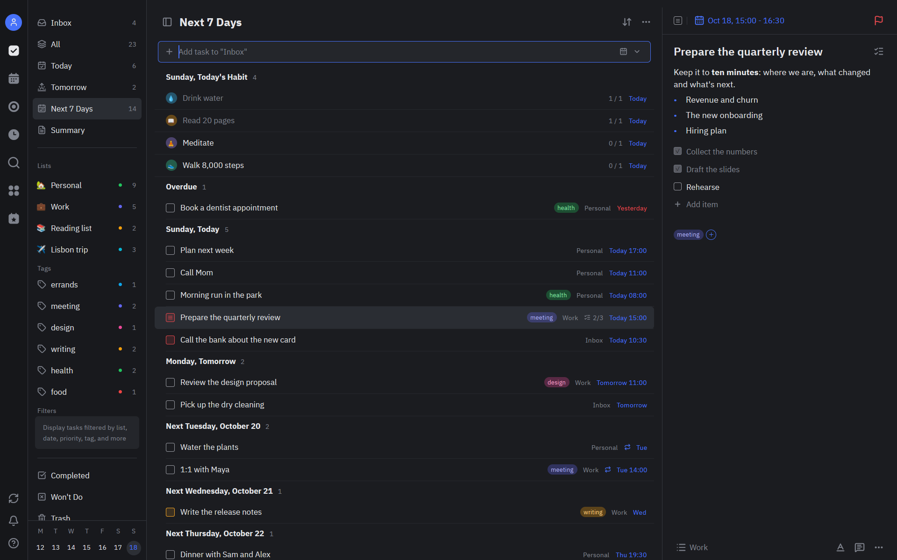
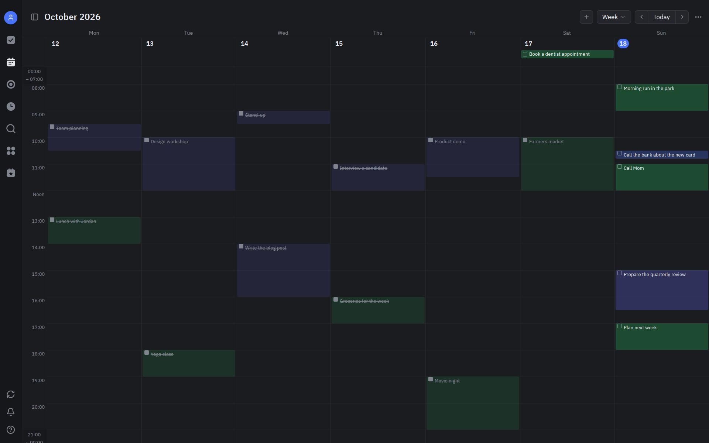
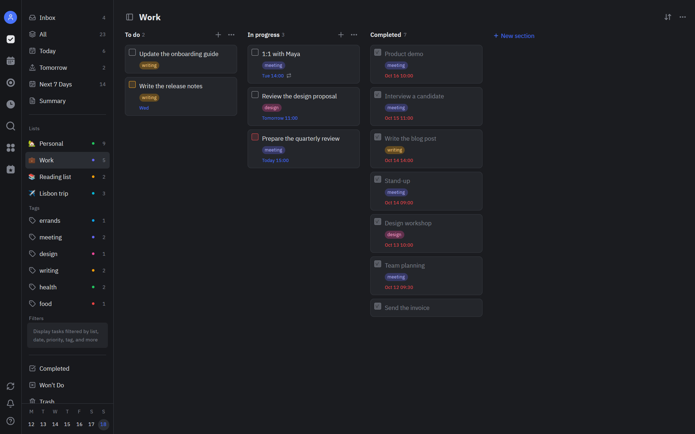
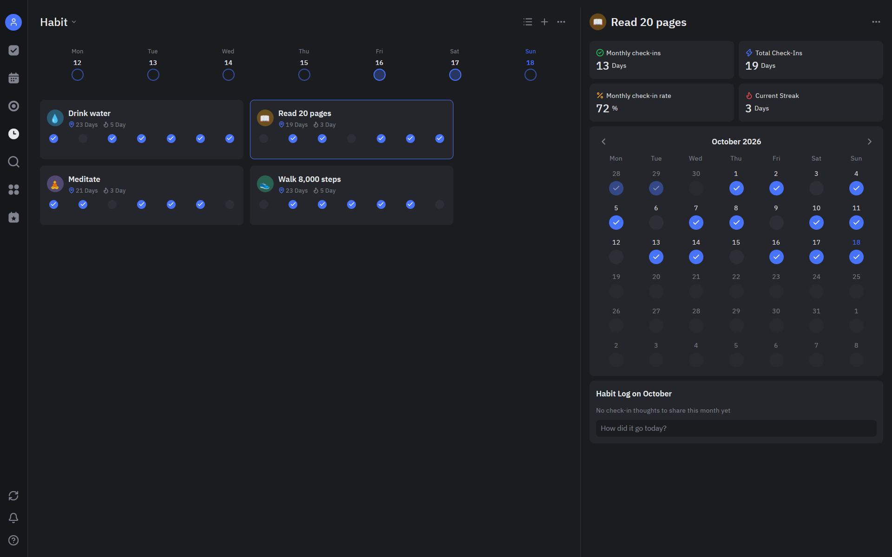
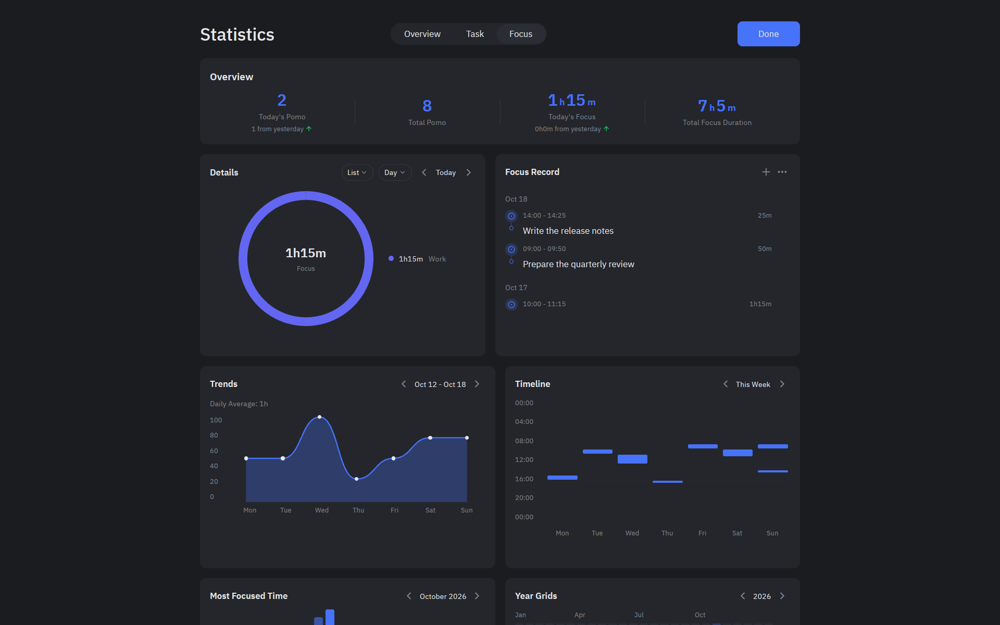
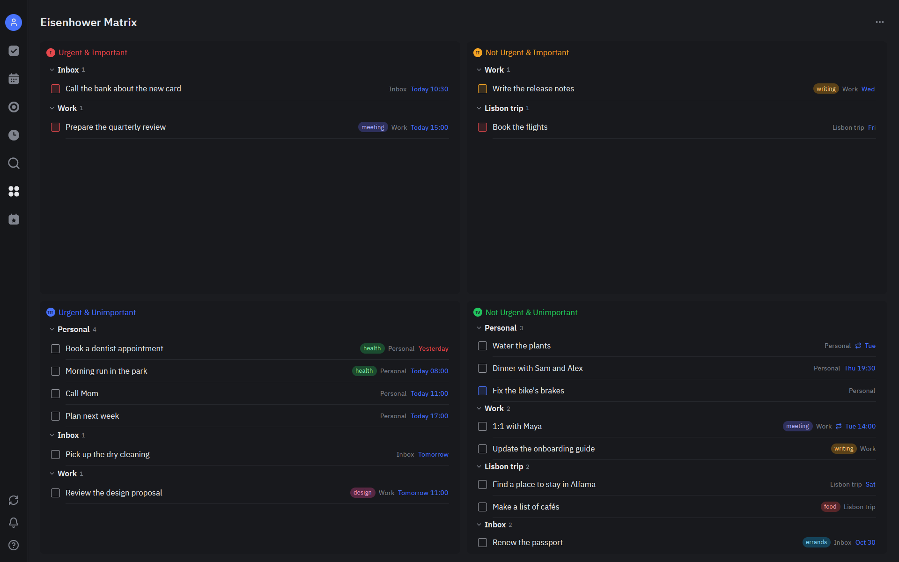
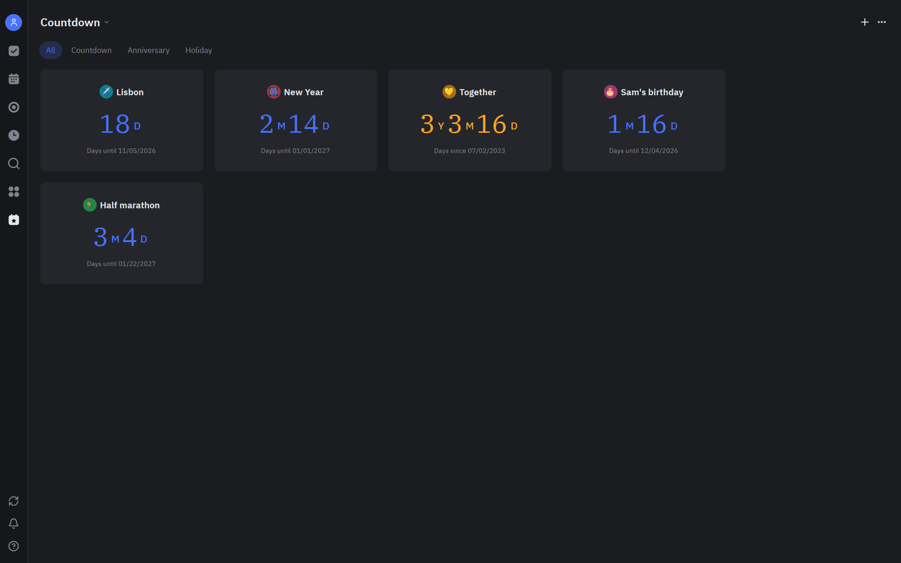

<div align="center">


# Fern

[](LICENSE)
[](https://www.rust-lang.org/)
[](https://github.com/atabits/fern/releases/latest)
[](https://github.com/atabits/fern/actions/workflows/ci.yml)

**Tasks, calendar, habits and focus in one native app.**
A free, open-source take on TickTick, written in Rust.
Download it and start working: no account, no server, your data stays on your machine.

</div>



> [!WARNING]
> **Fern is an early preview (0.1).** It already works for everyday tasks, but please read
> [the known limitations](#known-limitations) before you install it. In short:
> - Builds are not code-signed yet, so Windows and macOS warn about them.
> - There is no mobile app yet.
> - Sync needs a server you run yourself.

---

## ✨ Why You'll Love It

- **⚡️ Native and fast.** Rust and [GPUI](https://github.com/zed-industries/zed), the GPU-rendered UI framework behind the Zed editor. No Electron and no web view.
- **🗂️ Everything in one place.** Lists, tags, smart views, kanban boards, a calendar, an Eisenhower matrix, habits, a Pomodoro timer, countdowns and statistics.
- **⌨️ Quick add that understands you.** `Lunch with Sam friday 1pm #personal !2 ^Work` sets the date, time, tag, priority and list as you type.
- **🔒 Works out of the box, offline.** Download it and start adding tasks. There is no account, no sign-up and no cloud. Everything lives in one file on your disk, and Fern saves a copy of it every day.
- **🔄 Sync if you want it.** To use Fern on several devices, run your own `fern-server`. This is optional.
- **🌍 English and Russian.** Switch the language at runtime.
- **🆓 Free forever.** AGPL-3.0, no subscriptions, no ads.

---

## 📸 A Closer Look

| | |
|---|---|
|  **Calendar**: day, week, month, year and agenda views. |  **Kanban**: sections as columns. |
|  **Habits**: check-ins, streaks and monthly stats. |  **Statistics**: focus trends, timeline and records. |
|  **Eisenhower Matrix**: sorts tasks by urgency and importance. |  **Countdowns**: trips, birthdays, anniversaries and holidays. |

---

## 🚀 Quick Start

### Download

Every [release](https://github.com/atabits/fern/releases/latest) includes these builds:

| Platform | File |
|---|---|
| macOS (Apple Silicon / Intel) | `fern-<version>-macos-arm64.dmg` / `-macos-x86_64.dmg` |
| Windows (x86_64) | `fern-<version>-windows-x86_64-setup.exe` (installer) or `.zip` (portable) |
| Debian, Ubuntu (x86_64 / ARM64) | `fern-<version>-linux-<arch>.deb` |
| Any Linux (x86_64 / ARM64) | `fern-<version>-linux-<arch>.AppImage` or `.tar.gz` |
| Sync server (every platform) | `fern-server-<version>-<os>-<arch>.tar.gz` / `.zip` |

The builds are not signed yet (see [code signing](docs/code-signing.md)):

- **macOS:** the first time, macOS refuses to open Fern. Open System Settings → Privacy &
  Security and click "Open Anyway" next to Fern. You can also run
  `xattr -d com.apple.quarantine /Applications/Fern.app`.
- **Windows:** in SmartScreen, choose "More info" → "Run anyway".
- **Code signing policy:** Windows releases will be signed with free code signing provided by
  [SignPath.io](https://signpath.io), with a certificate by [SignPath Foundation](https://signpath.org).
  See the [policy](docs/code-signing.md#code-signing-policy), which also lists the team's roles.
- **Linux:** the `.deb` installs with a double click or `sudo apt install ./fern-*.deb`. The
  AppImage runs anywhere after `chmod +x`.

### Build from Source

```bash
git clone https://github.com/atabits/fern.git
cd fern
cargo run --release -p fern_desktop
```

You need stable Rust plus each platform's build tools:

- **Linux:** the libraries GPUI uses (Wayland or X11, xkbcommon, Vulkan, fontconfig). On Debian and Ubuntu, `script/linux-deps` installs them.
- **macOS:** Xcode, because GPUI compiles its Metal shaders with it. The app needs macOS 11 or later.
- **Windows:** Visual Studio Build Tools with the "Desktop development with C++" workload.

The first build compiles GPUI straight from the Zed repository, so it takes a while.

---

## 📖 How to Use

**Quick add** understands:
- dates: `today`, `tomorrow`, `friday`
- times: `6pm`, `18:30`
- tags: `#tag`
- priority: `!1` (high) to `!3` (low)
- list: `^List`

**Keyboard shortcuts** use `Ctrl` on Linux and Windows and `Cmd` on macOS:

| Keys | Action |
|---|---|
| `Ctrl+N` | New task |
| `Ctrl+F` | Search |
| `Ctrl+\` | Show or hide the lists column |
| `Ctrl+1` … `Ctrl+4` | Inbox, Today, Tomorrow, Next 7 Days |
| `↑`/`↓` or `k`/`j` | Move the selection |
| `Space` | Complete or reopen the selected task |
| `Delete` | Move the selected task to the trash |

Key bindings are defined in `assets/keymaps/default.json`.

**Your data** stays on your computer. Fern needs no account or server, and the first start
adds a few tips to the Inbox. Everything is kept in `tasks.db` in the `fern-tasks` folder of the
platform's data directory. Settings → Data & Sync shows the folder and has a button to open it.
- Linux: `~/.local/share/fern-tasks/`
- macOS: `~/Library/Application Support/fern-tasks/`
- Windows: `%APPDATA%\fern-tasks\`

Every day Fern saves a copy of the data to `backups/` and keeps the last seven. To restore
one, use Settings → About → Import Backups.

**Coming from TickTick?** Generate a backup in TickTick's settings, which gives you a `.csv` file. Then
import it in Fern with Settings → About → Import Backups.

**Sync between your devices** is optional. It works through a server you run yourself:

```bash
FERN_TOKEN=<a long secret> fern-server --listen 0.0.0.0:8650
```

Then enter the server's address and token in Settings → Data & Sync on each device.

---

## 🧼 Clean-Room Implementation

Fern is an independent project. Its look and behavior were recreated by using the publicly
available TickTick app as an ordinary user would. We clicked through its screens and compared
screenshots side by side. TickTick's source code, binaries, network traffic and assets were
never inspected, decompiled or copied.

Everything in this repository was written from scratch:
- the code;
- the icons, which come from [Lucide](https://lucide.dev);
- the fonts, which are [IBM Plex](https://github.com/IBM/plex).

Fern is not affiliated with, endorsed by or connected to TickTick or its developers. "TickTick" is
a trademark of its owner and is used here only to describe what Fern is inspired by.

---

<a id="known-limitations"></a>

## ⚠️ Important Notes

Fern 0.1 is an early preview. Here is what to expect:

- **Unsigned builds.** On first launch, Windows SmartScreen shows "Windows protected your PC"
  and macOS refuses to open the app. [Download](#download) explains how to open it anyway.
  Signing is being set up (see [code signing](docs/code-signing.md)).
- **Little testing on macOS and Windows.** Fern is developed and used daily on Linux. The
  macOS and Windows builds are built and tested in CI, but few people have run them yet.
  Please [report](https://github.com/atabits/fern/issues) anything that looks wrong.
- **Young software.** Bugs are likely. Fern keeps a daily copy of your data for the last week.
  Still, for anything important, use Settings → About → Generate Backup now and then. Newer
  versions upgrade the data automatically, but you can't open it in an older version again.
- **Desktop only.** There is no mobile app yet. An Android app is planned on the same core
  (`crates/core`, through UniFFI).
- **No hosted sync.** Fern works fully offline on one computer. To sync several devices, you
  run `fern-server` yourself.
- **No automatic updates.** To hear about new versions, choose Watch → Custom → Releases on
  GitHub.
- **Two languages.** The interface is in English and Russian. More languages are welcome.
- **Not everything from TickTick yet.** [docs/parity.md](docs/parity.md) tracks what matches the
  original and what is still missing. Team features such as shared lists and assignees are
  not planned.

---

## 🛠️ For Developers

```
crates/core      shared core: data model, SQLite storage, quick-add parser, sync
crates/ui        Zed-style UI components, with crates/theme, crates/icons, crates/assets
apps/server      fern-server, the self-hosted sync server
apps/desktop     the desktop app built with GPUI
docs/            architecture notes and feature parity with TickTick
```

```bash
cargo test --workspace     # run the tests
script/package <target>    # release packages into dist/, e.g. x86_64-unknown-linux-gnu
```

- CI builds and tests every push on Linux, macOS and Windows.
- Pushing a `v*` tag builds packages for all five targets and publishes a GitHub release.

Read `docs/architecture.md` before you start. The code follows Zed's conventions.

Contributions are welcome:
- Code, comments, docs and commit messages are in English.
- UI strings live in `apps/desktop/src/i18n.rs`. To add a language, fill in the `Strings` struct for it.

---

## 📄 License

Fern is free software under the [GNU Affero General Public License v3.0 or later](LICENSE).
If you distribute a modified version, or run one as a network service (for example, a sync
server), you must publish its source under the same license.

Third-party components:

- [GPUI](https://github.com/zed-industries/zed): Apache-2.0. `apps/desktop/src/text_input.rs` started from GPUI's `examples/input.rs`.
- Icons from [Lucide](https://lucide.dev): ISC. See `assets/icons/LICENSE`.
- [IBM Plex Sans](https://github.com/IBM/plex) for the UI and IBM Plex Serif for the countdown numbers: SIL Open Font License 1.1. See `assets/fonts/OFL.txt`.

---

## 💬 Get in Touch

**Built by Amin Atabiev**

- 📧 Email: [endlessspring.of@gmail.com](mailto:endlessspring.of@gmail.com)
- 🐙 GitHub: [@atabits](https://github.com/atabits)
- 🐞 Bugs and ideas: [issues](https://github.com/atabits/fern/issues)

---

<div align="center">

**⭐️ If you like this project, give it a star!**

Made with ❤️ and 🦀 Rust

</div>
